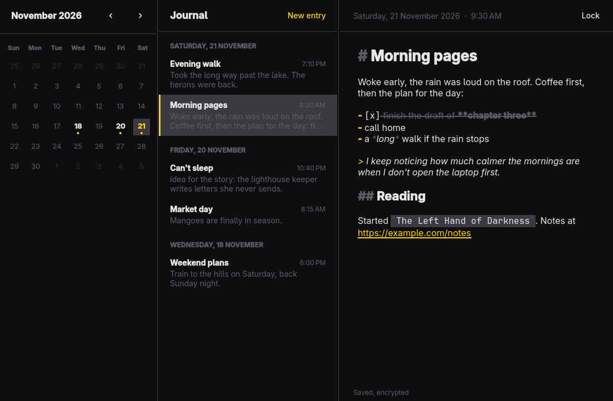

# Omajournal



An encrypted journal for [Omarchy](https://omarchy.org). Write entries in Markdown, find them by day on
a calendar or in a timeline, and keep them unreadable to anyone without your passphrase.

- **Calendar:** a month at a time, with a dot on every day that has entries. Pick a day to read it.
- **Live formatting:** Markdown is styled as you type (headings, **bold**, *italic*, `code`, lists,
  quotes, links), with its marks dimmed. Ctrl+B, Ctrl+I and Ctrl+E toggle them. The file stays plain
  Markdown.
- **Search:** Ctrl+F narrows the timeline to entries holding every word you type, whatever their case or
  accents, and highlights the matches.

It follows the Omarchy theme, light or dark, Hyprland's window rounding, and the language picked under
Setup > Language, all live.

## Encryption

- Every entry is encrypted on its own with XChaCha20-Poly1305 (libsodium), under a master key that your
  passphrase unlocks through Argon2id. File names are random, so they give away no dates or titles.
- At setup you get a **recovery key**. It's the only way back in if you forget the passphrase. Keep it
  somewhere safe, such as a password manager or on paper.
- Locking (Ctrl+Shift+L, or closing the window) saves the open entry, then wipes the key and every
  decrypted entry from memory. Nothing decrypted is ever written to disk.
- **Not hidden:** how many entries there are, their sizes, and when files changed. The passphrase can't
  be reset without the recovery key: lose both and the journal is gone. Full-disk encryption is still
  worth having underneath.

The file format is in [docs/format.md](docs/format.md).

## Sync and backup

The journal is a plain folder (`~/Journal` unless you chose another) that holds only encrypted files,
so any tool can copy it without seeing what you wrote:

- **Sync between machines:** [Syncthing](https://syncthing.net) works well. Every entry is its own
  file, so two machines rarely touch the same one.
- **Backups:** [restic](https://restic.net) or borg keep snapshots, so a deleted or damaged entry can
  be brought back. Syncing alone copies a mistake everywhere.

## Keyboard

| Keys | Action |
|---|---|
| Ctrl+N | New entry |
| Ctrl+S | Save now (entries also save on their own as you write) |
| Ctrl+F | Search entries (Down or Enter goes to the results, Escape closes) |
| Ctrl+B / Ctrl+I / Ctrl+E | Bold, italic, or code around the selection |
| Ctrl+1 | Go to the calendar |
| Ctrl+2 | Go to the timeline |
| Ctrl+3 | Go to the editor |
| ← → ↑ ↓ | In the calendar: move through the days (Enter opens one, Home goes to today) |
| PgUp / PgDn | In the calendar: previous or next month |
| ↑ ↓ | In the timeline: move through the entries |
| Enter | Edit the selected entry |
| Escape | From the editor back to the timeline |
| Ctrl+Z / Ctrl+Shift+Z | Undo / redo |
| Ctrl+Shift+L | Lock the journal |
| F1 | Show or hide the shortcuts |
| Ctrl+W / Ctrl+Q | Close or quit, locking first |

## Building

```sh
bin/build                                 # into build/
bin/test                                  # build, then run the tests offscreen
build/omajournal
cmake --install build --prefix ~/.local   # appear in the app launcher
```

It needs Qt 6 (base, declarative, svg, wayland), libsodium, and CMake.

## License

MIT. The build scripts, theme, and translator come from Omarchy's own apps.
